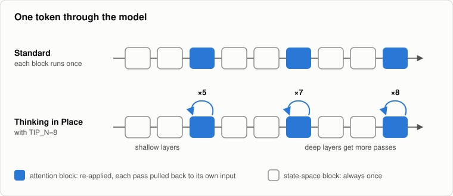
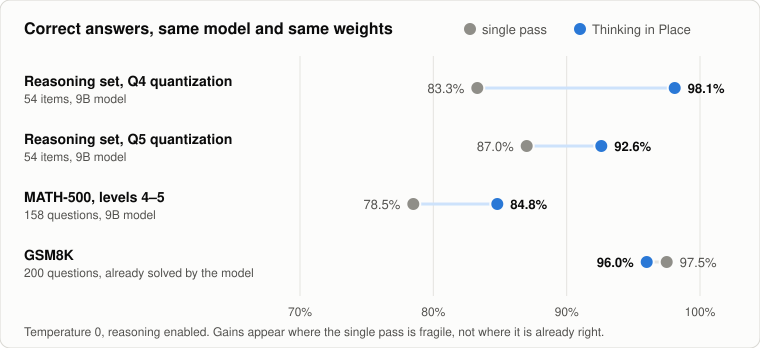

# Thinking in Place (TiP)

**Upgrade the model you already run.** No bigger download, no retraining, no extra weights: one variable, and a frozen model thinks harder when the question is hard.

[](https://doi.org/10.5281/zenodo.24507288)
[](https://github.com/Cocofraise/Thinking-in-place/releases/tag/v1.0)

<picture>
  <source media="(prefers-color-scheme: dark)" srcset="media/tip/tip-mechanism-dark.svg">
  
</picture>

Thinking in Place is a patch on top of [llama.cpp](https://github.com/ggml-org/llama.cpp). A model normally reads each token once through its layers. Here its attention blocks go over the same token several times, each pass anchored to where it started, before the next token is written. Nothing is trained and nothing is added to the file: you keep your GGUF.

- **Paper:** *Thinking in Place: Anchored Recurrent Depth and the Convergence of Modeling*, DOI [10.5281/zenodo.24507288](https://doi.org/10.5281/zenodo.24507288)
- **Windows + NVIDIA build:** [v1.0 release](https://github.com/Cocofraise/Thinking-in-place/releases/tag/v1.0)
- **Full documentation:** [TIP.md](TIP.md) (mechanism, settings, measurements, limits)

## What you get

<picture>
  <source media="(prefers-color-scheme: dark)" srcset="media/tip/tip-results-dark.svg">
  
</picture>

On a 9B model, a set of reasoning questions with a checkable answer goes from **92 to 103 correct out of 108**. Compared question by question, the loop wins 13 answers and loses 2.

<details>
<summary>The numbers behind the figure</summary>

| Test | Single pass | `TIP_N=8` |
|---|---|---|
| Reasoning set, Q4 quantization (54 items) | 45 | 53 |
| Reasoning set, Q5 quantization (54 items) | 47 | 50 |
| MATH-500, levels 4–5, numeric answers (158 questions) | 124 (78.5%) | 134 (84.8%) |
| GSM8K, first 200 test questions | 195 (97.5%) | 192 (96.0%) |

Temperature 0, reasoning enabled, one 9B model. The reasoning set is nine statements in six variants each, not 54 independent questions. Details and limits in [TIP.md](TIP.md).

</details>

**What it costs.** Time: about 2× per token on a 9B, 1.7× on a 35B mixture-of-experts. With speculative decoding most of that overhead disappears.

**What it does not do.** It brings no gain where the model is already right (GSM8K above), and it does not restore a capacity that quantization has destroyed.

## Try it

**Windows + NVIDIA, no build needed.** Download the two archives from the [v1.0 release](https://github.com/Cocofraise/Thinking-in-place/releases/tag/v1.0), unzip them into the same folder, then:

```
set TIP_N=8
llama-server.exe -m model.gguf -c 8192 -ngl 99
```

**Any other platform.** Build llama.cpp as usual from this repository, then:

```bash
TIP_N=8 ./llama-server -m model.gguf -c 8192 -ngl 99
```

Without `TIP_N` the output is identical to unpatched llama.cpp, so you can compare on your own prompts.

## Which models

Qwen hybrid attention / state-space models. Measured on Qwen 3.8 27B, Qwen 3.5 35B, Qwythos 9B, Ornith 9B and 35B, dense and mixture-of-experts. Other architectures are untested.

## Licence and contact

The Thinking in Place additions are shared for non-commercial use (PolyForm Noncommercial 1.0.0); llama.cpp itself stays under MIT. Commercial use requires a licence from the author. Details in [LICENSE-TIP.md](LICENSE-TIP.md).

Vincent Mathieu Malet · ORCID [0009-0003-9945-7296](https://orcid.org/0009-0003-9945-7296) · cocofraise974@gmail.com

The upstream llama.cpp README is kept unchanged in [README-llama.cpp.md](README-llama.cpp.md).
